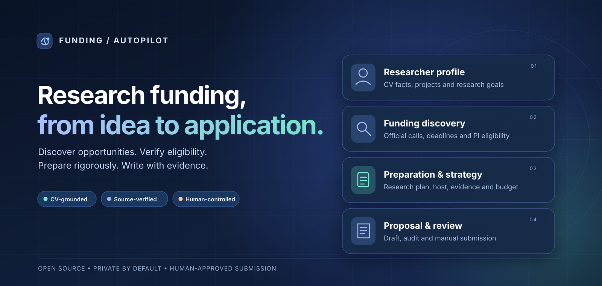
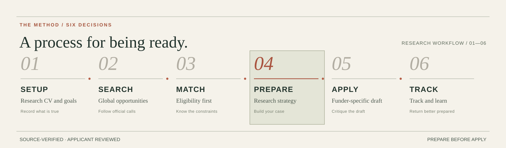
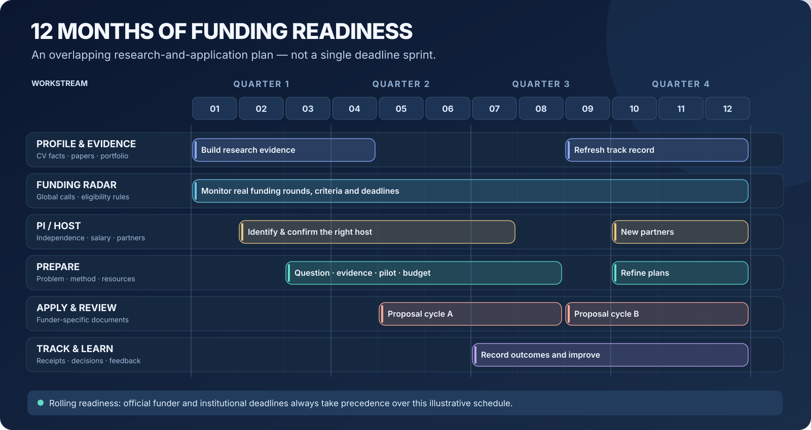
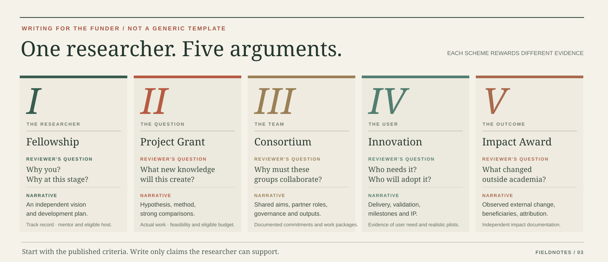

<p align="center">
  
</p>

<h1 align="center">Funding Autopilot</h1>
<h3 align="center">There are no researchers who cannot secure funding—only those who are not ready when opportunity arrives.</h3>
<p align="center"><em>Start long before the deadline. Stay ready when the opportunity comes.</em></p>

<p align="center">
  <a href="#quick-start">Quick start</a> ·
  <a href="#the-12-month-funding-roadmap">12-month roadmap</a> ·
  <a href="#writing-for-different-funding-schemes">Proposal strategies</a> ·
  <a href="docs/USER-WORKFLOW.md">Full guide</a>
</p>

**Funding Autopilot** is an **open-source, researcher-first funding workflow**. Upload your CV, find research funding across countries, check whether **you and your prospective PI/host** can apply, prepare a defensible research plan, then write and review documents for that funder's actual application form.

**Global by design:** Search in the UK, Europe, the US, Canada, Australia, Asia, and beyond using an AI host with web/search access. **This is not an exhaustive real-time worldwide grant database.** The standalone connector currently covers **UKRI's recent RSS feed**; other regions depend on host-side official-source research or additional adapters. Eligibility and institutional rules differ by country and scheme.

*A motto about sustained preparation—not a guarantee of funding. Eligibility, access, and selection remain real constraints.*

## Our difference: prepare the researcher, not only the proposal

- **CV-grounded and reusable.** Keep evidence-backed publications, projects, career milestones, skills and research directions in a private profile.
- **Eligibility before ranking.** Distinguish thesis submission vs PhD award, independent fellowship vs **new-PI/host-led** project, personal salary vs institutional grant budget, and university internal vs funder deadlines.
- **Match → Prepare → Apply.** Develop a specific research question, closest alternatives, feasible experiments, host and budget strategy **before** drafting the application sections.
- **Learn from every application.** Preserve actual source evidence, blockers, drafts, human-approved outcomes and negative results. A good topic match alone is not an eligibility pass.



## Compared with related projects

A comparison of **publicly documented focus**, not a benchmark or a claim that competing systems lack undocumented features.

| Project | What it already does well | Funding Autopilot's focus / honest trade-off |
| --- | --- | --- |
| **Funding Autopilot** | Open-source, researcher CV profile, verified eligibility gates, separate Prepare phase, private application ledger | Explicit **PhD / independent researcher / new PI / host / salary** decisions; worldwide *agent-assisted* research, but **not** a global indexed database |
| [PaperBreak](https://paperbreak.ai/) | Research-grant discovery, eligibility, writing and review; indexed EU/UK/German opportunities | Its packaged live discovery is more developed; ours emphasizes **open-source local records and career-/PI-aware preparation** |
| [GrantWell](https://github.com/The-Burnes-Center/AI4Impact-GrantWell) | US state/federal NOFO matching, requirements analysis, chat writing and a document editor | Ours is a **portable academic funding Agent Skill**, rather than a US-oriented grant-writing web editor |
| [grant-finder](https://github.com/openprose/grant-finder) | Self-hostable, source-cited **US** grant-discovery CLI and public-data ingestion | Stronger built-in US source ingestion; ours adds **CV → eligibility → research preparation → application writing** across host-researched regions |
| [Grantable](https://grantable.co/) | Nonprofit/organization-focused grant research, RFP checklists, organizational memory and writing | Our unit of planning is the **individual researcher**, with career-stage and host transition constraints |

**We do not claim to be the first AI grant finder or grant writer.** Our differentiator is the combination of *researcher-specific evidence, eligibility-first decisions, independent preparation, and repeatable application records*. [Comparison notes and official sources](docs/PROJECT-COMPARISON.md).

## The 12-month funding roadmap

The best time to start a funding application is often **before** its call is announced. Keep evidence, opportunity monitoring, PI/host relationships, research preparation, proposal writing and feedback moving together.



**M01–M12 is an illustrative rolling plan, not a funder's fixed calendar.** Actual calls and receiving-institution deadlines take precedence. In Claude Code, `/year-plan` can generate a **private 12-month plan** using the uploaded CV and actual recorded calls; it is a one-time planning step, **not** background monitoring. [Year-round preparation guide](docs/YEAR-ROUND-READINESS.md).

## Writing for different funding schemes

The **same CV does not justify the same proposal** for every funding type. The agent first reads the official scoring and eligibility rules, then chooses a fitting narrative.



| Scheme | Central argument | Prepare the right evidence |
| --- | --- | --- |
| **Fellowship / postdoctoral award** | Why **you**, why now, and why your independent research vision? | Track record, own contribution, development aims, PhD timing, mentor/host |
| **Research project / PI-led grant** | What specific new knowledge will this method produce? | Gap, falsifiable hypothesis, comparators, evaluation, work packages, budget |
| **Collaborative / consortium grant** | Why must these partners work together? | Partner responsibilities, project governance, letters, shared outcomes |
| **Industry / innovation grant** | Who needs it, and can the team deliver and validate it? | Users, milestones, pilots, allowable costs, IP and adoption evidence |
| **Impact / engagement award** | What **external impact has already occurred**? | Beneficiaries, verified adoption, measurable change and attribution |

These are research-writing patterns, **not substitutes for the actual call's form**. [Detailed proposal strategies](docs/PROPOSAL-STRATEGIES.md).

## How the agent reasons

```text
Uploaded CV + career goals + target regions
    ↓
Expand search across official funders and applicant roles
    ↓
Check the exact current-round rules, host & internal deadline
    ├─ Ineligible  → record why; search another route
    ├─ Conditional → verify PhD date, new PI, salary or host
    └─ Eligible    → develop and review a research strategy
                         ↓
                    Write → critique → repair → human approval
                         ↓
                    Track actual submissions and feedback
```

The process is **source-linked and revisable**, not an estimated funding-success probability. Calls remain conditional when real approval or evidence is missing.

## Quick start

```bash
git clone https://github.com/Yunbo-max/Funding.git
cd Funding
claude
```

Within [Claude Code](https://claude.com/claude-code), upload your CV and use:

```text
/setup       CV and research goals
/search      Find official opportunities in selected regions
/match       Compare real eligibility and source-backed fit
/year-plan   Build a private 12-month funding plan
/prepare     Develop project aims, PI/host and budget strategy
/apply       Write, independently review and format the proposal
/outcome     Record actual submissions and decisions
```

`/rank` remains a legacy alias for `/match`. Other Agent Skills-compatible hosts can use [the skill](skills/funding-autopilot/SKILL.md) through natural language. The AI host needs real web/document tools; the local Python helper does not itself write complete grant prose.

### Example: input → output

**Input** — `[Upload: my-CV.pdf]` followed by:

> “I study trustworthy AI agents and expect to submit my PhD thesis in November. Search the UK, EU, US, Canada and Singapore. I want to move to a new PI and ideally fund my own salary. Find routes I could actually pursue, plan the next year, and prepare an application.”

**Output** — illustrative structure (**these are not verified live funding opportunities**):

| Candidate route | Example status | Evidence or decision needed |
| --- | --- | --- |
| Individual fellowship | Conditional | PhD awarded vs thesis submitted, by the actual eligibility date |
| New PI-led project grant | Conditional | Host/PI consent, institution deadline and salary-eligible budget |
| Permanent-faculty-only award | Ineligible | Applicant role does not meet the call's explicit criteria |

Once the user chooses a **real verified call**, the agent develops an actual research plan and only then opens the proposal draft:

```text
private/                           # Not committed to public GitHub
  profile.json                     # CV facts reviewed by the applicant
  ledger.json                      # Calls, roles, sources and decisions
  annual-plan.md                   # Optional, AI-authored /year-plan
  applications/call-…/new_pi/
    preparation.md                 # Research aims, comparisons and host strategy
    preparation.json               # Evidence map and reviewed section outlines
    requirements.md                # Official form and sign-off checklist
    pi-outreach-draft.md           # NOT SENT
    proposal.md                    # Funder-specific draft after Prepare
    application.json               # NOT SUBMITTED
```

**What actually runs today:** CV extraction, private applicant/call state, conservative rule checks, a UKRI RSS discovery adapter, preparation gates, grant-specific draft scaffolds and outcome tracking. **Worldwide web research, full proposal prose, independent content review and final DOCX/PDF rendering require an AI host with those tools.** Grant submission, email and recurring monitoring are never automatic. [Full setup and implementation notes](docs/INSTALL.md).

## Privacy and attribution

Private CVs, unpublished research plans, budgets and PI correspondence stay in Git-ignored `private/`. There are **no GitHub Actions or automatic submissions**. An official source and applicant/host approval remain necessary for consequential application claims.

Inspired by [AI Job Search](https://github.com/MadsLorentzen/ai-job-search) and [Research Autopilot](https://github.com/Yunbo-max/Research_Autopilot). Independently implemented · [MIT License](LICENSE) · [Full guide](docs/USER-WORKFLOW.md) · [Visual identity](docs/ART-DIRECTION.md).
